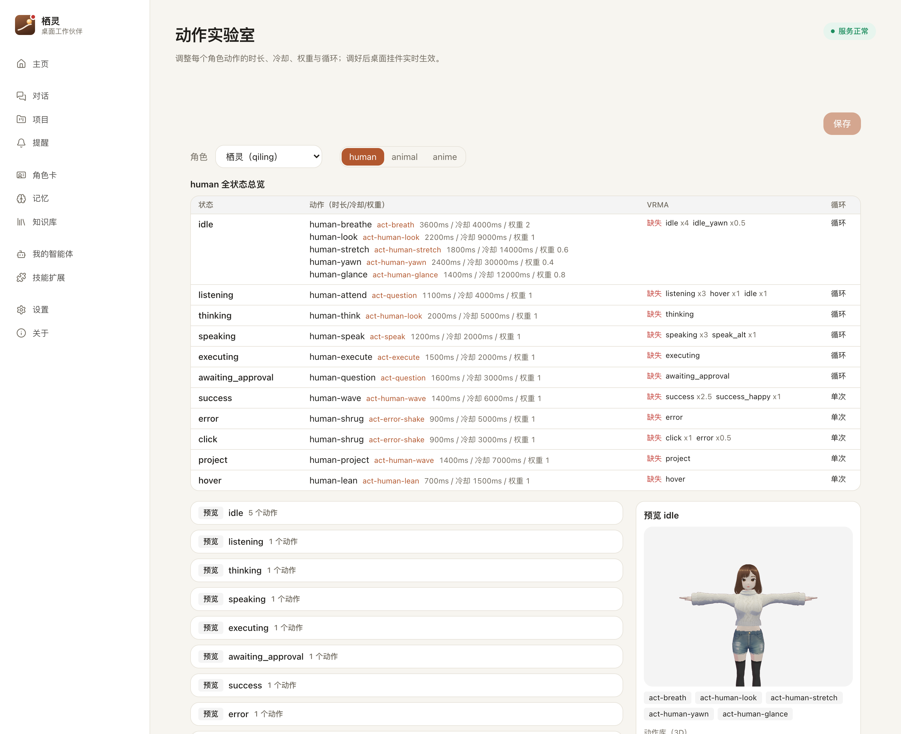

# 栖灵 Qiling v0.1.0

> 本地优先、角色化、懂项目上下文的 AI 工作伙伴。
> 她住在你的桌面上：有形象、能说话、记得你项目做到哪一步，复杂任务交给已有的 Agent 执行。

## 截图

## 这一版有什么

**一个住在桌面上的角色**

- 3D VRM 角色常驻桌面：透明背景、可拖动、置顶、双击打开主界面
- 11 类状态各自动作（待机 / 倾听 / 思考 / 说话 / 执行 / 等授权 / 成功 / 出错 / 点击 / 项目 / 悬停），加权随机 + 冷却，不会一直重复同一个动作
- 口型随播报变化，动作实验室 `#/motion-lab` 可实时预览和调参
- 2D 立绘路线并行保留，自备 PSD 可做眨眼 / 口型 / 发飘等器官级动效

**说话就能用**

- 常开 VAD，唤醒词或静默指令切换监听
- STT → 对话 → TTS 全链路闭环，支持音色克隆
- 主界面隐藏时把语音租约交给挂件，挂件自动接管「听」

**记得你的项目，不是每次从零开始**

- 项目级记忆：进度、技术决策、失败根因、下一步
- 会话和任务事件自动归档，下次接着上次的状态聊
- 项目节点可视化，任务收口时自动推进节点进度

**复杂任务交给现成的 Agent**

- 任务自动分流：直接回答 / 前端执行 / 委派后端 / 请求授权
- 内置 Codex（ACP）真实提交、进度回流、取消与授权
- WorkBuddy、浏览器执行器、本地办公兜底可选接入
- 执行器按需安装，默认只启用 Codex 与浏览器，不拖慢启动
- 高风险操作必须显式授权，授权卡片显示真实命令，超时按拒绝收口

**办公文件能读也能写**

- Word / Excel / PPT / PDF / 图片 / 邮件 六类本地读取
- Markdown 一键导出 docx / xlsx / pptx / pdf，内置排版引擎兜底
- 装了 docxtpl / Typst 就自动增强，没装也能出文件

**其他**

- 首次启动三步向导（模型 → 角色 → 语音），启动自检直接告诉你哪项坏了、去哪修
- 中英文双语一键切换
- 本地优先：记忆、语音、任务数据默认留在设备上

## 下载安装

从 [Releases](../../releases) 下载对应平台安装包（无需自备 Python，运行时已内置）：

| 平台 | 文件 |
| --- | --- |
| Apple 芯片 Mac | `Qiling_*_arm64.dmg` |
| Intel Mac | `Qiling_*_x64.dmg`（macOS 12 Monterey+） |
| Windows | `Qiling_*_x64-setup.exe`（Windows 10 1809+ / 11，自带 WebView2 引导） |

v0.1 **尚未购买代码签名证书**，首次打开会有系统安全提示，属正常现象：

- **macOS**：提示「无法验证开发者」或「已损坏」时，把 Qiling 拖进「应用程序」后**右键点应用 → 打开**确认一次；仍不行则执行
  `xattr -dr com.apple.quarantine /Applications/Qiling.app`
- **Windows**：SmartScreen 蓝色警告点「更多信息 → 仍要运行」

首次启动需要填一个 OpenAI 兼容的模型地址与 API Key（语音可选，不填也能用文字对话）。浏览器执行器的 Chromium 内核不随包分发，首次使用时按提示下载。

## 已知限制

- macOS arm64 包尚未在 M 系真机验收（会随 v0.1.x 补）
- Windows 包尚未完成真机实装回归
- Mixamo 参考片派生的动作库随包分发，根目录 `NOTICE` 已声明来源；长期计划用自制动作替换
- 未签名，安装时会有系统警告

## 接下来

- **v0.2**：可自定义工作台 —— 自己新增快捷链接、内嵌网页、内置功能入口，附便签 / 待办 / 多时区时钟
- **v0.3**：电商运营 / 跨境业务 / 数据处理垂直模板

## License

[PolyForm Noncommercial License 1.0.0](../LICENSE)：非商业用途可自由使用、修改、再分发；商业用途（含企业内部商用）需事先取得作者书面授权，联系方式见 LICENSE。
